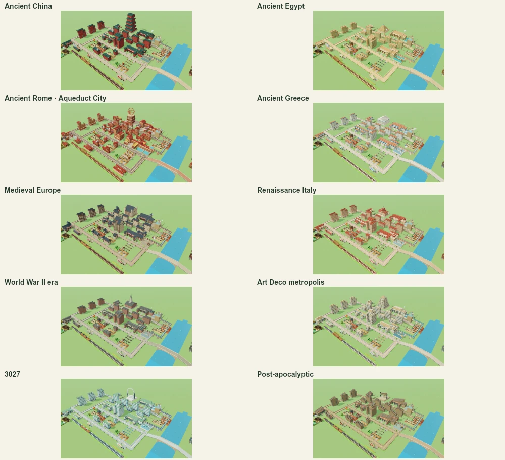
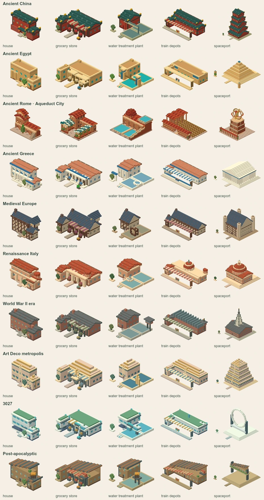

# Pixel Civilization

Build an island city, give its residents a route to work, and watch what happens when a field, waterworks or railway joins the neighborhood. Play in the browser or take a saved island offline. [Play Pixel Civilization](https://pixelcivilization.app/) · [Download for Android or Windows](https://pixelcivilization.app/downloads.html)

## Three islands to try

| Island | Try this in the game |
| --- | --- |
| [Reedbank · Ancient Egypt](https://pixelcivilization.app/#world=ancient-egypt-starter&era=ancient-egypt&view=0) | Put a mudbrick courtyard home on the open parcel. Select it and check which street serves its entrance. |
| [Porta Fluminis · Ancient Rome](https://pixelcivilization.app/#world=rome-district&era=rome-aqueduct&view=1) | Follow spring water around the aqueduct bend to the baths. At the passenger railway, open **City → Transit** and follow a train between the two stations. |
| [Orbital Commons · 3027](https://pixelcivilization.app/#world=future-3027-skyline&era=future-3027&view=0) | Start above the dense riverside city. Zoom in on the residential quarter, select an apartment and compare its four designs in the Atlas. |

Each era has a free starter street, a working district and a mature skyline. To try a different look on your own save, open **More → View**, preview a time period, then choose **Apply to island** or **Cancel preview**. [Explore all 30 sample islands](https://pixelcivilization.app/eras.html) · [Compare the same river crossing in every era](docs/review/period-production/cities/compare-crossing.webp)

## Learn by building

- **Inspect a building.** Rotate the model, step through its levels and switch variants. The Atlas link remembers your selection. [Open a level-two Egyptian courtyard home](https://pixelcivilization.app/field-guide.html?id=house&level=2&variant=3&era=ancient-egypt)
- **Try the waterworks.** Practice on the Roman aqueduct, then compare the same supply chain in a different era. [Open the Roman Handbook exercise](https://pixelcivilization.app/handbook.html#course=rome-flow&era=rome-aqueduct)
- **Find a design.** Browse all 294 elements in the illustrated catalog, including the supported levels and four visual variants per level. [Browse the art index](docs/review/period-production/art/index.md) · [See an actual delivery, transit arrival and water outage](docs/review/period-production/art-and-cities.md)
- **Keep an island.** Open **More → Saves** to manage islands and **More → Account** to connect your saves. The downloadable editions also save on the device. [Player guide and editions](docs/time-periods.md)

