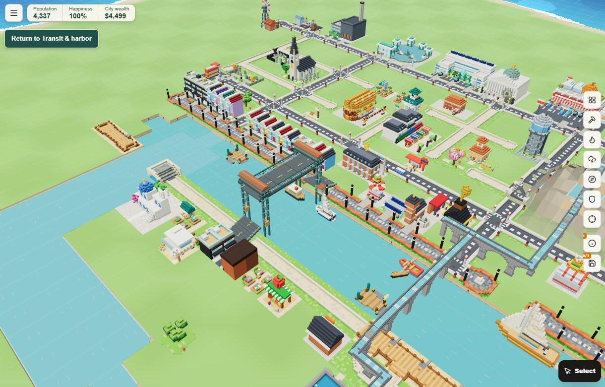

# Pixel Civilization · Connected Island

The island has 204 buildable elements and four visual styles for each. The field guide shows every modeled stage, its footprint, moving parts and a real neighbor you can add beside it. Bus stops stay on one tile and finish upgrading at level three. Existing cities keep their older level-four and level-five shelters.

## Illustrated player handbook

Open **Game menu → Illustrated player handbook** to explore the illustrated chapters. The **Design atlas** lets you search every element, compare every modeled level and style on one sheet, check its footprint and requirements, and open the same design in the rotatable field guide. On a running server you can also visit `/handbook.html` directly.

## Explore the three islands

Open **Game menu → Example islands** in any mode. Pelican Reach has a working harbor and a navigable estuary. Copper Gorge follows freshwater from mountain springs to farms and hydropower. Switchyard City has night trains, a fire response and a working spaceport. Each island has guided stops and saves separately. The east road in Copper Gorge connects its high school and sports field to the dairies and temple.

The expanded map is 192 × 192 tiles. For a hands-on tour, see [the feature checklist and three island playthroughs](island-playchecks.md). The **Worlds** and **Land & water** chapters include photographs of the game and labeled engineering examples.

## Try the canal district

1. Open **Island tools → God controls → Explore the canal district**. The game saves your current sandbox as a snapshot. The district opens with two working quays, a mountain aqueduct, a lift bridge and three transit services.
2. Open **Transit & harbor**, expand the passenger ferry and choose **Follow vehicle**. Its passengers count toward the transit score when they reach their destination. The harbor master can send a boat to a point on the water or call it home.
3. Open **Land & water**. Select the bridge or enter its middle tile at **0, 0**, choose a low stone arch and preview the work. The preview identifies vessels and services affected by the change. Reopen the passage with a lift, raise the deck, or choose **Undo last works**.
4. Tap **City wealth** to see where money is held, how it moves and which of the 22 projects your city can build. Select a farmhouse, garden or grocery store to see its local workers, water, production or stock. The **Connections** inspector identifies its working entrances and neighboring parcels.
5. Use **God controls** to pause and step the clock, set or hold a value, start an incident, or restore your earlier snapshot. The main menu can also open a separate God-mode copy of a Real or Survival city.

## Growing a town

In Real and Survival modes, give homes and workplaces usable entrances. Put a garden at a back gate, join fields around a farmhouse, and connect food, water and employment to the people who need them. Revenue, wages, spending and upkeep change three balances. Wealth milestones unlock projects, while construction comes out of the treasury. Open the selected building's site panel to see what its next level needs and how much space it will take.

Terrain tools unlock with the settlement. Roads, footways and rail can cross a channel on separate decks. Vessel beam, draft, mast height and turning space determine where a boat can travel. Powered pumps, springs, gates, aqueduct outlets, channel banks and reservoirs govern freshwater delivery. A transit line needs reachable stops and a suitable depot or landing. Fire cover depends on civic authority, crews, water and an actual route to the incident.

## Running the game

Use `npm install` and `npm run dev` for development. Run `npm run build` followed by `npm start` to play the production build. The island, field guide and illustrated handbook are production entry points. Run `npm run lint` and `npm test` to check the code and game rules.

## Working on an element

Category builders in `src/game/designs/` define building stages, eleven vehicle-road standards, the four styles, and moving parts. The catalog's footprint table also works before any graphics are loaded. The catalog tests compare it against every builder, generate every visual state and detect repeated models across the available combinations.

The development gallery accepts element IDs, network connection patterns and lighting settings. For example, open `/gallery.html?cat=maritime&ids=sail_boats&mode=full&cell=220&water=1` on the development server to compare every sailboat.

## Testing the expansion

Choose **Game menu → Example islands → Copper Gorge**, then choose **The east campus and creamery** in the island guide. Select the High School or Dairy Farm and open **Connections**. The next viewpoint shows the temple and its sandbox controls. A Train Depot opens **Rail Operations**. The **Campuses & farms**, **Roads & rail** and **Faith & recovery** handbook chapters explain the systems and link directly to their designs.

To create a portable testing copy, run `npm run build` followed by `node scripts/build-preview.mjs ./portable`. Open the generated **Connected Island/index.html**. The export includes the playable examples, handbook, field guide and a standalone searchable atlas. Browser saves belong to the preview location and browser profile.

For the hands-on checks and screenshots, see [Playtesting the expansion](master-expansion.md).

## Earlier design notes

The other notes in this directory record Claude's intermediate checkpoint. Its detailed voxel artwork set the visual direction for the completed catalog. The images under `public/assets/aistudio/` document earlier versions of the game.
