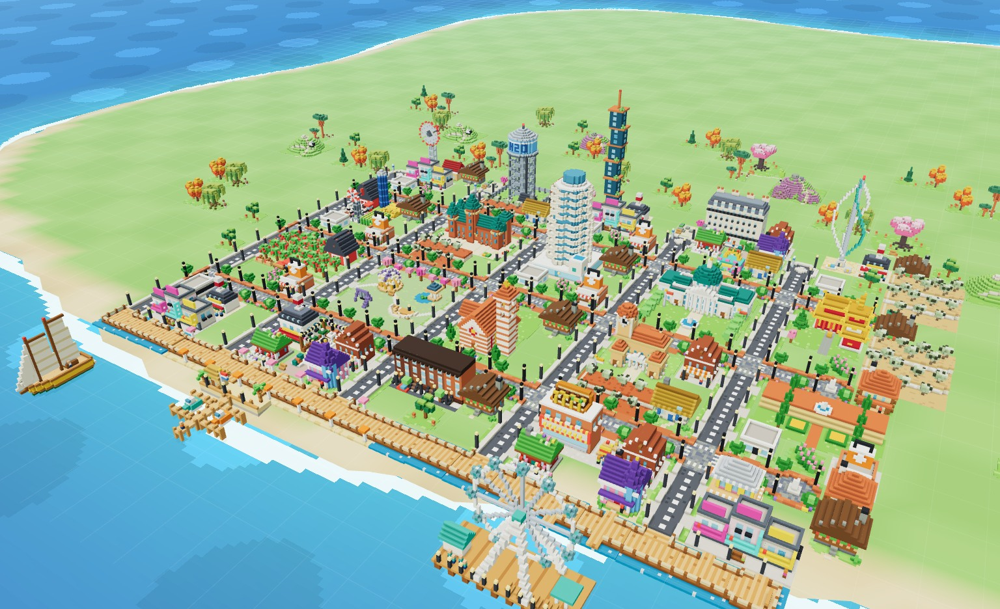

# Pixel Civilization redesign

The playable catalog has 149 models, each with five growth stages and four visual styles. From the game menu, open **Island field guide** to inspect any model, rotate it, compare stages and footprints, or switch to night lighting. Selecting a building on the island also gives you a link to its current level and style.

## Running the game

Use `npm install` and `npm run dev` for development. Run `npm run build` followed by `npm start` to play the production build. Both the island and the field guide are production entry points. Run `npm run lint` and `npm test` to check the code and game rules.

## Working on an element

Category builders in `src/game/designs/` define the five named stages, the four styles, and moving parts. The catalog's footprint table also works before any graphics are loaded. The catalog tests compare it against every builder, generate every visual state and detect repeated models across the twenty combinations.

The development gallery accepts element IDs, network connection patterns and lighting settings. For example, open `/gallery.html?cat=maritime&ids=sail_boats&mode=full&cell=220&water=1` on the development server to compare every sailboat.

## Earlier design notes

The other notes in this directory record Claude's intermediate checkpoint. Its detailed voxel artwork set the visual direction for the completed catalog. The images under `public/assets/aistudio/` document earlier versions of the game.
