# Round 2 preview playcheck

## Play the new island

Open the illustrated handbook, choose **Meridian Fair**, and select **Play in Real mode** for a city with operating costs. **Explore in God mode** opens a separate copy of the same island. Your personal island and edits to each example have separate saves. The four illustrated district lessons have a **Visit this viewpoint** link which opens the camera on that spot.

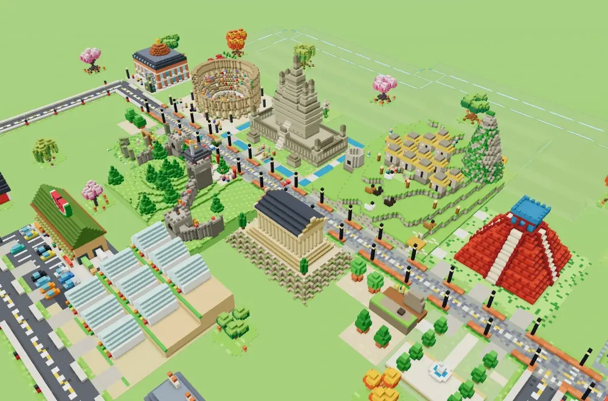

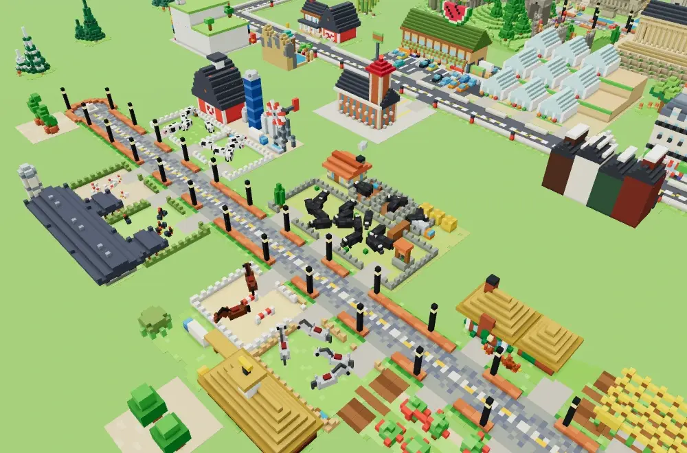

College Walk includes the schoolhouse, preschool, elementary, middle and high schools, technical and community colleges, university and research university. Tomorrow Quay links the spaceport, paired teleportation depots, planted arcology and offshore habitat. The handbook links to the design sheets for all eleven campus designs and all twenty-two wealth projects.

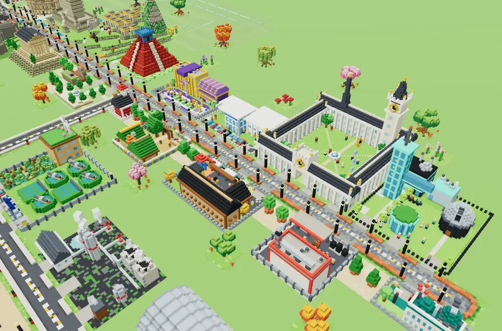

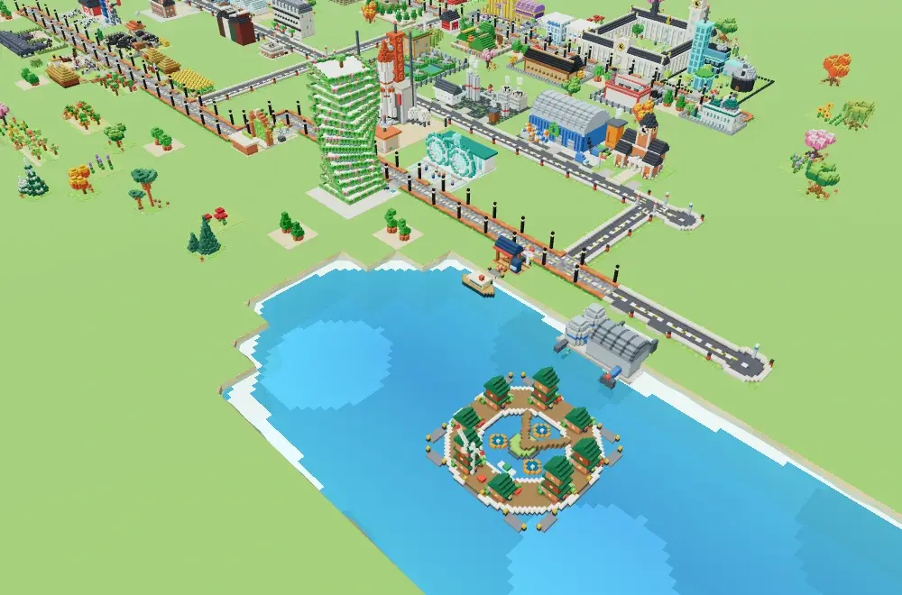

## Real-mode play

Each run opened the built game in a clean browser context, visited an island-guide stop, changed tax by one point in City → Money and kept the island running for over three minutes of wall time. The game speed control was set to 4×. The last column is the need setting the population ceiling at the end of that run. All four runs completed with zero console errors, uncaught page errors or failed asset requests.

| Island | Viewport | Wall time | Simulated time | Population | Treasury | Limiting need |
| --- | --- | ---: | ---: | ---: | ---: | --- |
| Pelican Reach | 1400 × 900 | 184 s | 365 s | 3,147 → 3,244 | $33,409 → $41,578 | food |
| Copper Gorge | 430 × 930 | 184 s | 666 s | 3,221 → 3,320 | $18,778 → $38,104 | jobs |
| Switchyard City | 1400 × 900 | 186 s | 490 s | 6,607 → 6,811 | $443,001 → $530,757 | waste |
| Meridian Fair | 430 × 930 | 183 s | 761 s | 12,000 → 12,371 | $567,113 → $683,330 | waste |

## Checks on phone and desktop

- Built a house, upgraded it and tapped Undo. The inspector restored the previous level and left the house standing. In Real mode a $60 house reduced the treasury from $28,460 to $28,400. After a reload, Undo removed the house and restored the full $28,460. Checked separate receipts for road widening and bridge upgrades. Toasts can be dismissed while paused, and More → Settings keeps an accessible Undo action after the toast disappears.
- Reproduced a town with 4,353 people and power for only 1,821. City → Issues → Build power opened the Solar Panels placement tool. Checked the Homes filter against actual housing capacity and confirmed that a zero population ceiling remains visible.
- Changed the Real tax slider to 14%. In Survival, 6% tax and auto-maintenance survived a reload. Changed God-mode clock settings and stepped one simulated second. Exercised Water, Aqueduct flow and Food layers, including toggling a layer off.
- In Switchyard City, opened Lines, Fleet, Freight and Yard. Added a train, retired it, changed a turnout and saved a third station on both Market Local trains. The free platform at Flying-Car Depot Halt is an editable extension. The default service links Spaceport Halt and Grocery Store Halt.
- Opened Orchard Valley from Switchyard’s island guide in Real mode. Its prepared bridges previously failed the player’s construction-stage check. The yard now opens without charging the treasury or changing modes. Its Freight tab identifies the actual grain producer and receiver. A five-minute run delivered 292 units of grain.
- In a separate 600-second rail simulation the two trains delivered **1,500 passengers**, 779 and 721 respectively. They had routes in progress at the same time for 247 seconds, used both sides of the passing loop and passed without an emergency overlap.

| Build | Diagnose a shortage | Adjust tax |
| --- | --- | --- |
| 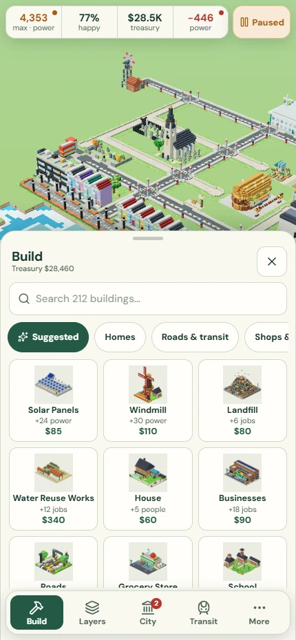 | 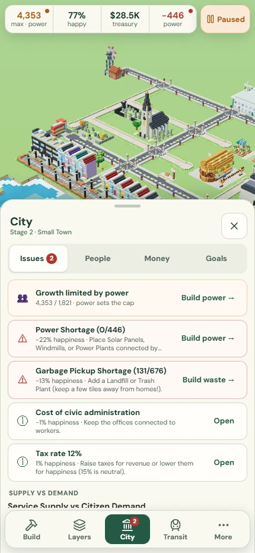 | 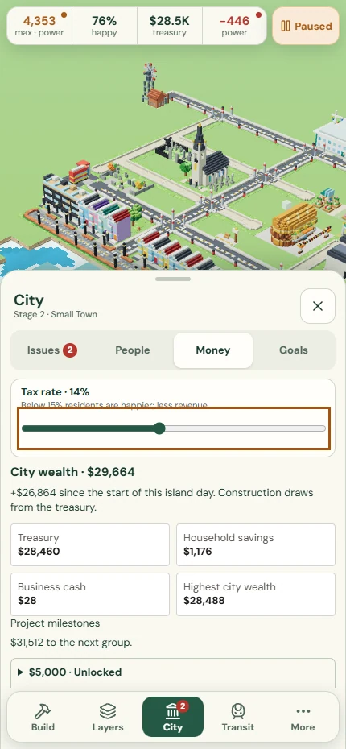 |

| Water coverage | Two trains on one line | Ordered station editor |
| --- | --- | --- |
| 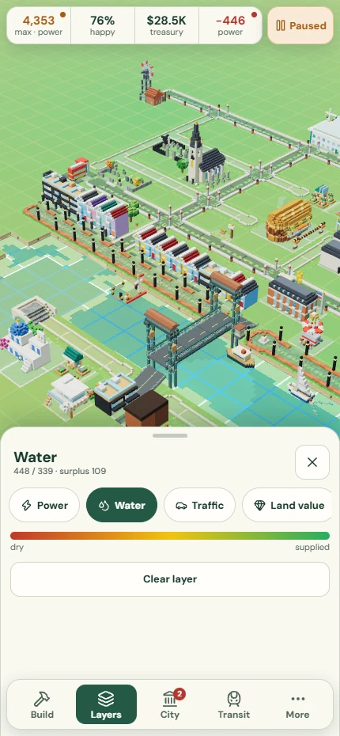 | 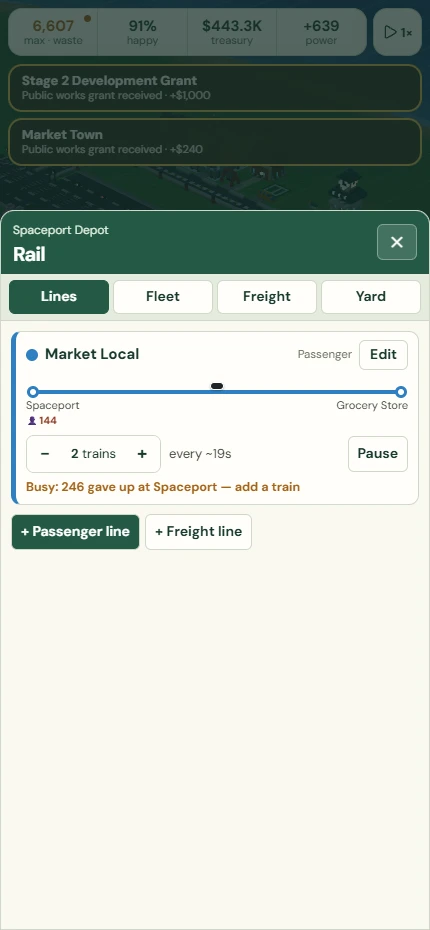 | 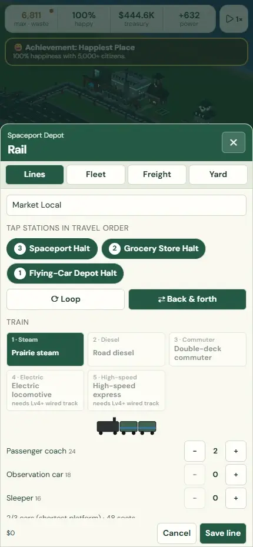 |

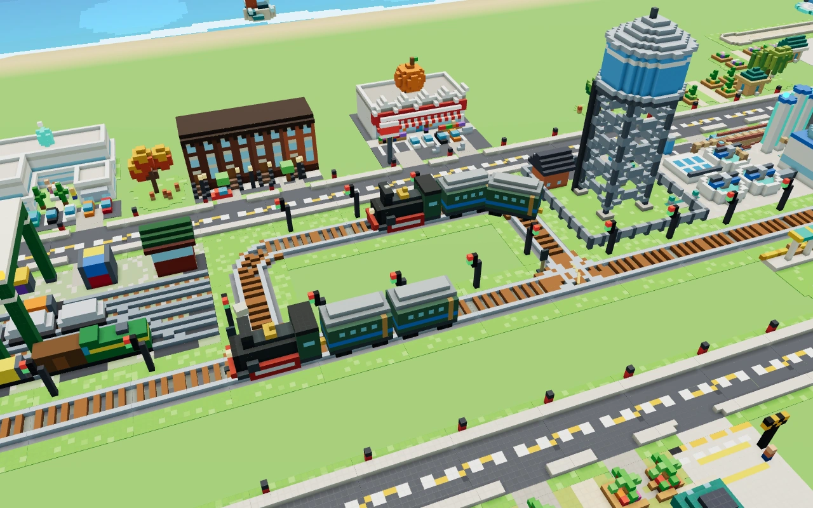

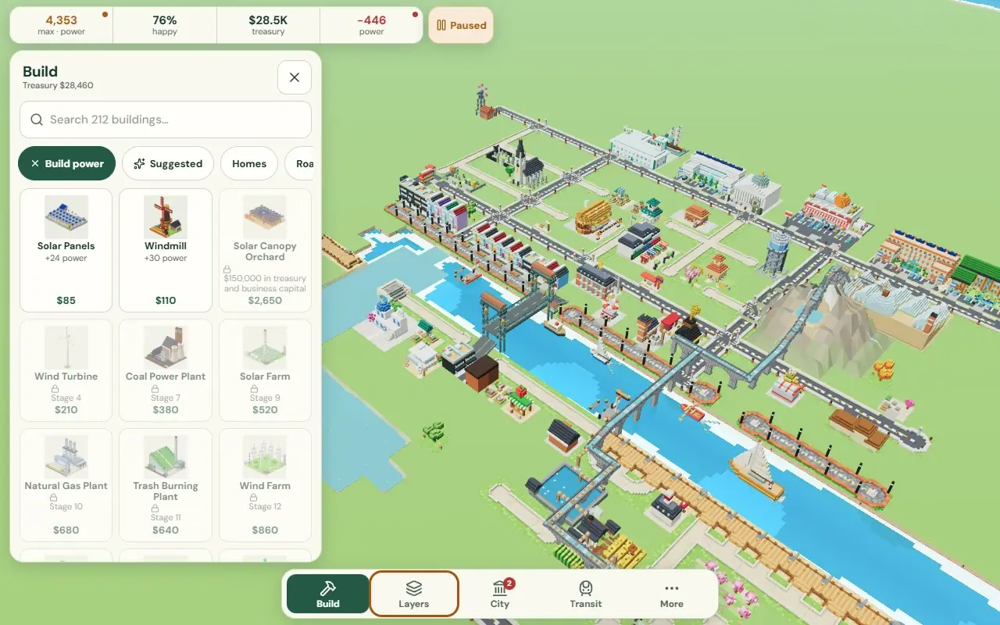

## Atlas and offline preview

The atlas contains 212 elements. All 4,504 illustrated cells decoded and contained visible artwork. There are 4,496 playable level and style combinations. The eight remaining cells show the four styles of the two legacy bus-stop levels. New bus stops finish at level 3. Road and bridge designs that support eleven levels retain all eleven.

Regenerated the eight historical plates and refreshed farms, livestock, transit and neighbor plates. Printed farm illustrations now include the same animal coats and positions as the still 3D model. Every field-guide entry links to at least one operating lesson. The handheld and desktop views use the same navigation and controls. An offline browser opened the exported handbook, selected Angkor Wat in the field guide, followed its operating lesson into the plaza, searched Build for Machu Picchu and opened the standalone atlas without a network request. The local development preview also passed its live-reload connection check after restart.

The release build and TypeScript check passed, and all 370 automated tests passed. The packaged ZIP was unpacked and compared against all 548 exported files. The final district photos match the files in the archive.

## Reproduce the checks

Run `npm run lint`, `npm test`, `npm run build` and `node scripts/build-preview.mjs ./portable`. The portable directory contains the game, handbook, field guide, four island launchers, ZIP and searchable standalone atlas. Open the ZIP after extracting its contents.

For the browser checks, install Playwright or Playwright Core and set `CHROME_PATH` when using a system browser. `node scripts/review/check-portable.mjs` opens the files from disk. `scripts/review/play-examples.mjs` takes an optional list of example IDs and uses `PREVIEW_URL` for the game address and `OUT` for the measurements and screenshots. A fresh context keeps checks independent of the player's saves.
