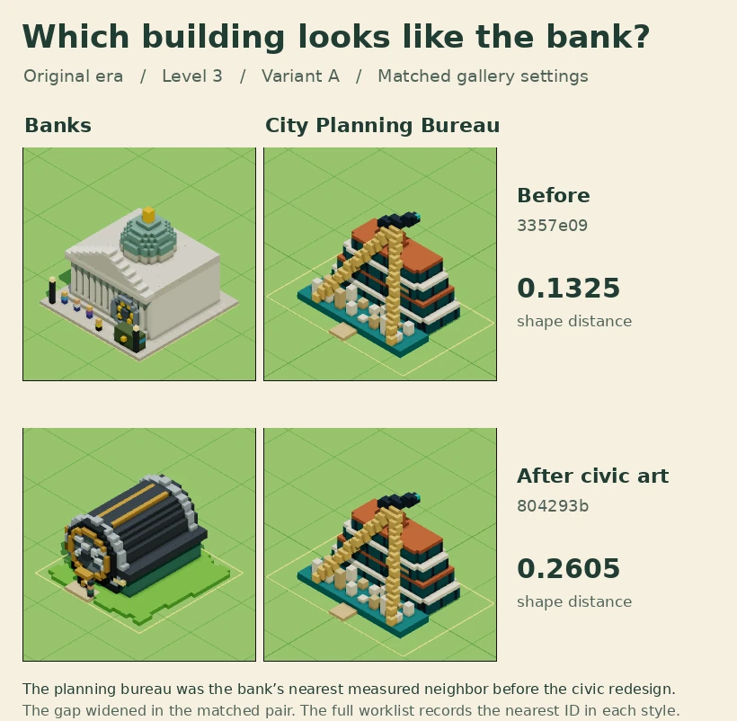

# Catalog art worklist

[Browse every element and the coverage counts](INDEX.md). The index links each canonical ID to its registered Original builder. A ticket combines the actual model, labels, footprints and measured geometry in one style with the element's proposed A–D layout directions.

The starting baseline for this worklist is [merged main at f072a22, after the commercial neighbor review](https://github.com/FuzzyMediaco/Pixel-Civilization/commit/f072a2207a83e344f3c3206105bd35ecee573ca4). The original brief counted 294 elements. This inventory includes 302 year-round elements across 13 categories and 20 elements in the seasonal Christmas category. The 322 IDs have 6,696 playable level/variant combinations per style. The Original style and ten production eras yield **73,656 selectable presentations**. Each style contributes 400 seasonal presentations through the same Original winter art. Counting that set once gives 69,656 presentations before any other cross-style model reuse. Rome’s alternate Forum pilot sits outside these totals.

Of the 322 IDs, 310 have five levels, eleven vehicle roads and bridges have eleven levels, and Bus Stops has three levels. The inventory asks the catalog for each element's limit and dimensions. Every supported level has four variant slots.

## Look up a design

From the repository root with Node 24 and project dependencies installed:

```sh
node --import tsx scripts/review/catalog-worklist.mjs --show=ancient-egypt/public_library
node --import tsx scripts/review/catalog-worklist.mjs --show=original/bus_stops
node --import tsx scripts/review/catalog-worklist.mjs --show=rome-aqueduct/highways
```

The human-authored plan files hold the [elements' overhead cues and four layout directions](directions.txt), [era-specific spatial approaches by kind of work](era-directions.txt), and [70 era-specific plans for the civic five, farm and waterworks](era-elements.txt). A row with `@variants` quotes the four Original display names when those names already describe the proposed architectural choices. A proposed form in these files is a brief for the artist. A merged comparison or the Cheesesteak Spot benchmark receives a separate [evidence entry](evidence.txt).

Each style snapshot is JSON Lines. The first record identifies the era and the SHA-256 of the relevant source tree, review code and evidence ledger. Each remaining line describes one canonical ID in alphabetical order.

| Field | Reading the ticket |
|---|---|
| `model`, `original`, `family`, `joinedDeck` | The registered Original builder file and the style's primary parcel builder. The production path resolves signatures ahead of Roman pilot or shared families. Highways and freeways also use the joined high-resolution carriageway builder in the Atlas. |
| `usesOriginalAtL1A` | An instrumented L1 A call through the normal illustration path records whether it reaches the Original builder. A true result can describe a retained working model with a period surround. Joined high-resolution decks have a separate build path. |
| `labels`, `name`, `variants` | The resolved element, level and variant labels and their source modules or resolver. A `signatureMismatch` marks a signature with missing era-specific labels or labels without matching art. Variant indexes 0–3 are player slots A–D. |
| `levels` | Each entry contains the live level name, unrotated tile footprint, and four voxel counts in A–D order. Counts include resting movable parts and animals. Joined highway/freeway illustrations include three high-resolution pieces. |
| `originalGrowth`, `eraDescription` | The registered design's growth note and, where present, the era display specification’s description. Some eras currently share a district-wide description. |
| `nearest` | The closest other ID at L3 A in the same style, followed by the distance. The comparison includes all categories. A zero can also describe two empty above-ground silhouettes. |
| `repeatVariants`, `repeatLevels` | Identical voxel coordinates and material IDs within one element. A fingerprint match triggers an exact per-coordinate comparison. Entries hold level and variant pair, or upgraded level and variant. |
| `nearVariants`, `lowGrowth` | A variant pair with silhouette distance under 0.12, or an adjacent upgrade under 0.06. The final number is the distance. |
| `state`, `evidence` | Merged review evidence, the art brief benchmark, a prior baseline reference, shared seasonal art, or an open review. An existing builder, an era signature or an automated pass alone leaves a review open. |
| `overhead`, `layouts`, `eraDirection` | The artist’s proposed recognition cue, four distinct compositions and a style-specific direction. When an era supplies its own four layouts they replace the element-wide starting points. All ten era library briefs have their own four. |
| `source`, `matchesCheckout` | Fingerprint of the measured snapshot and whether it matches the current review inputs. A changed Original machine can affect several production styles. |

## Refresh and inspect

```sh
# All 11 styles, then regenerate the Markdown index.
node --import tsx scripts/review/catalog-worklist.mjs

# Rebuild one style during an art pass. The index reports any older snapshots.
node --import tsx scripts/review/catalog-worklist.mjs --era=ancient-egypt
node --import tsx scripts/review/catalog-worklist.mjs --index

# Inspect the actual gallery after a candidate appears.
node node_modules/vite/bin/vite.js --host 127.0.0.1 --port 5173
GALLERY_PORT=5173 node scripts/shoot-gallery.mjs 'cat=all&ids=banks,city_planning_bureau&mode=variants&lv=3&era=original' /tmp/bank-neighbors.png
```

The generator uses the same voxel illustration routine as the Handbook, with a straight connected tile for ordinary networks, the Atlas's three-piece layout for wide carriageways and an active service state. The distance combines a 12×12 overhead height field, two elevations and occupied area. It ignores color and lettering. Small scores prioritize captures at normal play zoom. Repeated geometry can be intentional on constrained networks. Interactive joins, changing activity, camera motion, playability and human identification require in-game review.



In the pre-civic library snapshot at `3357e09`, the City Planning Bureau was the Original bank's nearest measured neighbor at L3 A. With the new bank at `804293b`, their distance rose from 0.1325 to 0.2605. The comparison uses the same two canonical IDs, level, variant, lighting and gallery camera settings. The final worklist recomputes the nearest other ID from its full catalog.

## Add an element

When a new canonical ID enters the catalog, add one line to `directions.txt` with its overhead cue and four layout choices. Prefix a confirmed future ID with `?` to prepare the plan before its registration. The next refresh activates that plan automatically once the ID exists. An unplanned ID fails generation with its name. Run the full refresh after registering its art and labels, inspect the gallery at every supported level, then record the merged evidence against the correct era and ID. New seasonal pieces follow the same registration and use the shared-seasonal route. Add a primary label catalog to the source mapping if a new catalog module supplies names.

The next civic and military slices have these planned elements. Their presentations enter the counts when canonical definitions land. The three commissioned civic IDs already have prepared plan rows.

| Requested element | Overhead cue | Proposed layouts A–D |
|---|---|---|
| Climbing-wall city offices | Public square faces an occupied office wall scaled by visible climbing routes | Straight climbing court · Split corner wall · Terraced bouldering garden · Overhanging civic arch |
| Civic Exchange Viaduct | Two service wings share a public gallery above a through-passage | Timber crossing hall · Cascade arcade · Lantern truss hall · Market arch exchange |
| Levitating split office | A full story of daylight separates the upper office volume and lower public lobby | Split drum · Cantilevered crescent · Offset stacked prisms · Open-ring sky office |
| Underground silo | A fictional surface hatch interrupts a mostly open landscaped parcel | Round hatch court · Paired flush doors · Sunken light ring · Grass-covered service mound |
| Drone-swarm base | A clearly readable departure court and tiny animated formations dominate the skyline | Perch tree · Ring court · Stepped balconies · Open hangar fan |

Independent city-zoom recognition sessions and physical-device checks are tracked in the redesign progress log. The inventory records geometric evidence and authored intent.
