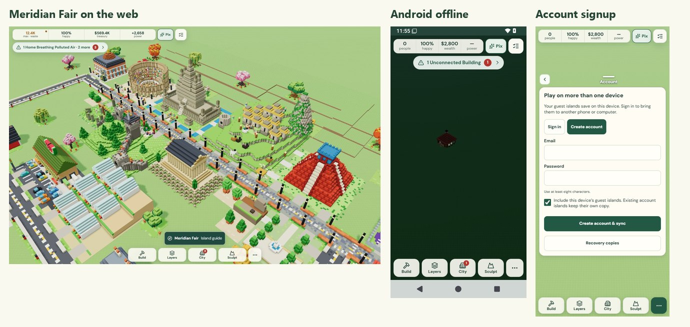

# Player accounts and offline editions

The public game is at [pixelcivilization.app](https://pixelcivilization.app/). Install the [Android or Windows edition](https://pixelcivilization.app/downloads.html) for a complete local copy of the game, its artwork, and the handbook.

## Bring an existing island across

1. Open the browser or installed copy where you last played. For an island built on the [original Cloudflare address](https://pixel-civilization.fuzzymedia.workers.dev/), start there in the same browser.
2. Choose **More → Account → Create account**. Enter your email and a password of at least eight characters. Leave **Include this device’s guest islands** checked, then choose **Create account & sync**.
3. Open Pixel Civilization on the other device and choose **More → Account → Sign in**. If both devices changed the same save while disconnected, choose the version to play in Account. The other version is available under **Recovery copies**.

Guests can continue without an account. Browser guest saves belong to the browser profile and site address. An installed edition keeps its own local copy. Signing in links these copies through the same game account. Sign-out returns the device to its guest islands. Clearing the game's storage or uninstalling can erase device-only saves.

## Audit findings

| Area | Finding and verification |
| --- | --- |
| Water | The old ocean shader applied a moving threshold pattern across deep water. With the same fixed camera, game speed and 264 × 230 ocean sample, 47.82% of pixels changed between two frames of the old game. The new sample had zero changed pixels. Shore foam still follows the shoreline. |
| Large saves | Meridian Fair exceeded the previous browser storage limit. Changing the tax from 12% to 13% was lost on reload. The same island now persists in IndexedDB and retains the new rate on reload. The legacy import covers existing islands, named slots and settings. |
| Cloud accounts | Isolated browsers created an account, signed in and restored the changed island. Worker tests cover account isolation, expiration, sign-out, concurrent saves and interrupted writes. Local Cloudflare runtime tests round-tripped a 7,350,000-character save through the database. |
| Offline conflicts | Two devices edited the same save while disconnected. The account flow lets the player choose a version and preserves the other copy for recovery. |
| Existing live features | Compared the prior live frontend against a build from GitHub. Restored the gallery build entry and the live Pix model label. The existing Pix service, budget and account-independent game assets continue to use the game's Cloudflare Worker. |
| Installation and updates | The installers embed the web game. They check the published edition when online and download changed files into separate storage. Only a complete, hash-verified edition is selected on the next launch. Player saves live outside those replaceable files. |
| Browser offline play | The service worker previously cached the front page without its required code on a first visit. A production-build test loaded an island, went offline, reloaded the website and restored the player's island. |
| Navigation and display | Checked the in-game Downloads and Account controls, email/password flow, narrow-screen download layout, handbook and atlas. The account panel has its own solid backdrop so text stays readable over buildings. |
| Public release | Confirmed an existing guest island could move from the original Cloudflare address to a fresh phone-sized browser on the new domain. Verified the two public GitHub downloads against their signed-off builds. Found and corrected Cloudflare's HTML analytics injection on native update requests, then verified every published game file against its update checksum. |
| Gameplay spot checks | Placed a house, used Undo to remove it, switched through all five modes, turned on the Copper Gorge water overlay, and opened Pelican Reach's two-line transit dashboard. These checks surfaced a keyboard focus issue when closing or switching panels. |
| Simulation and build | The automated suite covers game modes, rendering data, terrain, water, roads, transit, economy, schools, examples and persistence. Type checking, production bundling and the production dependency advisory check are part of the release audit. The browser still downloads a sizeable 3D engine and art library. |

## Publishing future builds

Apply pending account migrations with Wrangler before publishing an API change. Build the site with the locked dependencies and `npm run build`. Deploy the entire resulting `dist` with the repository's Wrangler configuration and set the `SOURCE_COMMIT` variable to the published Git commit. The offline update index is generated in that same build. For native changes, follow the [package build instructions](../../packages/README.md), sign the Android package with the existing release key, and attach both files to a GitHub release using the documented filenames.
