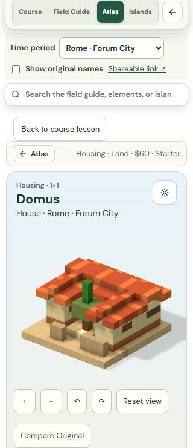
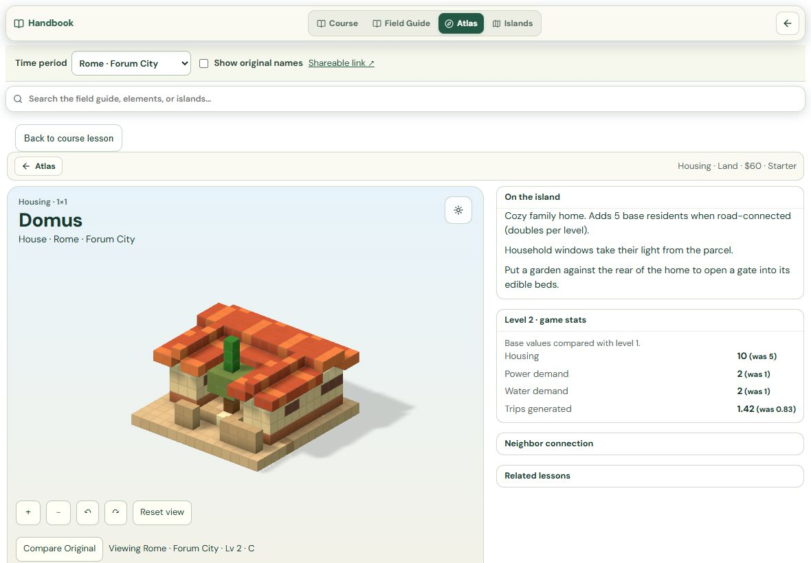
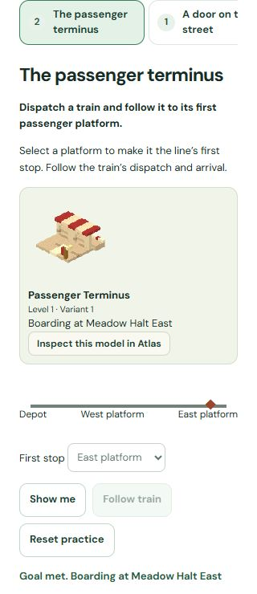
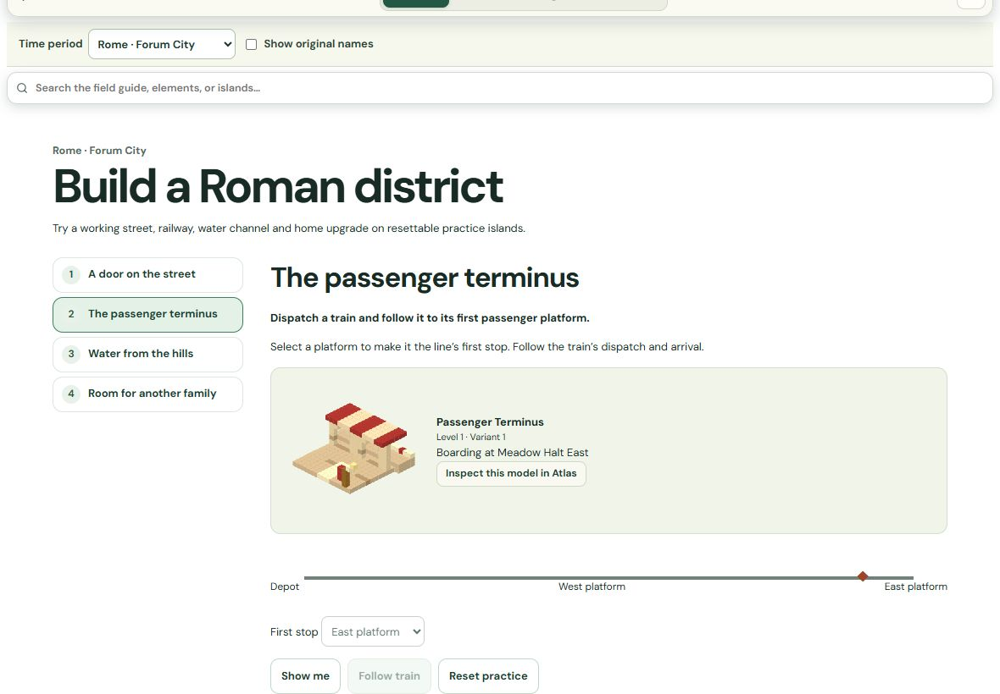

# Rome Handbook and Atlas

In the Handbook, choose **Rome · Forum City** or **Rome · Aqueduct City** under **Time period**. The Course opens four exercises. Each starts with its own playable state and has a reset button. You can open the starter street, working district or mature skyline in a separate tab and keep your lesson open.

| Exercise | What to try | What to look for |
| --- | --- | --- |
| A door on the street | Build a house next to the market street. | The house gains access to the same road component as the market. |
| The passenger terminus | Choose the west or east platform and dispatch a train. | The marker follows its actual track position. The train reports boarding at the chosen stop. Pause the trip or reset and try the other platform. |
| Water from the hills | Lower the middle aqueduct span between the spring and receiving pool. | The water simulation changes the pool from disconnected to supplied. |
| Room for another family | Inspect the level-one Domus in the Atlas, compare the next level, return to the lesson and upgrade the house. | The house reaches level two and the fixture's housing capacity rises from five to ten. |

## Inspect a model

Search for a canonical name such as **House** or an era name such as **Domus**. Choose a level and a lettered variant. **Compare Original** preserves the selection and viewing angle. Drag to orbit, pinch or use the zoom buttons, and choose **Reset view** to return to the opening angle. Open **Neighbor connection** to inspect a joined example. The active-state button on supported models is an explicit demonstration. The practice exercises read the service simulation.

**Shareable link** opens the exact model, era, level and variant. A link opened from a lesson also retains its lesson destination. Example handbook fragment: `#design=house&level=2&style=3&era=rome-forum&course=rome-upgrade`. The standalone field guide accepts `?id=house&level=2&variant=3&era=rome-forum`. Both use one-based numbers. Bus stops clamp to their three playable levels.

## Verification

The browser review exercised both directions, model comparison, touch-sized controls, the upgrade round trip, water delivery, the east-platform train arrival, and out-of-range links. The phone viewport was 320 CSS pixels wide. Forced WebGL initialization failure also exercised four illustrated angles and a joined track model. The simulation regressions dispatch real trains to both platforms and check housing, street access and restored water flow.

The production-build offline check started in Original with no Rome pack request. Applying Rome downloaded the pack once. With the network disabled, the saved 15-site island and its level-two, third-variant Domus both reopened. Two fresh browser profiles also opened a shared Atlas link or Handbook link as their first visit and reloaded the same interactive model offline. Reproduce with `node scripts/review/rome-offline.mjs` against a production build on port 5384, or set `ROME_PREVIEW_URL` and `CHROME_PATH` for another local installation.

| Phone | Desktop |
| --- | --- |
|  |  |
|  |  |
