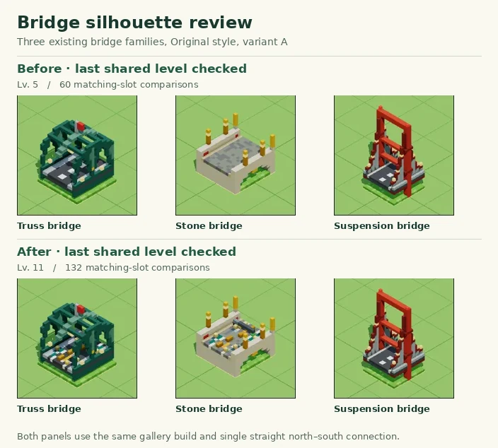

# Silhouette review coverage



The gallery shows three existing Original bridges at the previous and current upper limits for cross-element comparison. Both rows use source revision `4593a5a` with a single north–south connection, variant A. Each pair of elements now runs through its highest shared playable level. The three bridge families have eleven levels, while a bridge paired with a windmill has five shared levels.

| Cross-element audit of three bridge families | Comparisons |
| --- | ---: |
| Previous matching slots through level 5 | 60 |
| Current matching slots through level 11 | 132 |
| Current all A–D combinations through level 11 | 528 |

`slots=matching` compares A with A, B with B, C with C and D with D. `slots=all` also compares pairs such as the first building’s A and the second building’s D. The JSON records how many cross-element pairs ran. Each comparison below the configured distance appears in `lookalikePairs`. The separate `closeVariants` and `flatUpgrades` sections cover variants within each building and consecutive upgrades respectively.

`parts=base` preserves the original distance calculation over fixed model voxels. Existing reports used that measure. `parts=parked` includes zero-rotation moving meshes at their actual pivots and penned animals in their resting poses, shared with the Handbook illustration pipeline. Compare distance scores across reports using the same `parts` setting. Both settings sample a 12×12 overhead height field and two street-facing elevation profiles. The review uses the individual parcel model. Connected bridge runs also need inspection through the island renderer.

The three Original bridge families had zero cross-element distances below `0.12` in both current runs. They still produced 192 close variant pairs and 104 flat upgrades. The windmill’s level-five A silhouette reaches 31 voxels in the base geometry and 44 with its parked blades. Matching colors, motion and detail still need visual review.

## Rerun

```sh
node --import tsx scripts/review/near-silhouette.mjs ids=bridges,stone_bridges,suspension_bridges eras=original slots=matching parts=base
node --import tsx scripts/review/near-silhouette.mjs ids=bridges,stone_bridges,suspension_bridges eras=original slots=all parts=parked
node --import tsx --test tests/reviewSilhouettes.test.ts
bash scripts/gallery-server.sh
node scripts/shoot-gallery.mjs 'cat=all&ids=bridges,stone_bridges,suspension_bridges&mode=levels&variant=0&net=one&mask=5&cell=190' /tmp/bridge-levels.webp
```

The board uses the level-five and level-eleven columns of the gallery. `production-art.mjs` fingerprints the complete TypeScript design tree recursively, including nested era signatures, and the shared raster sources. New coverage reports store this source SHA-256.
