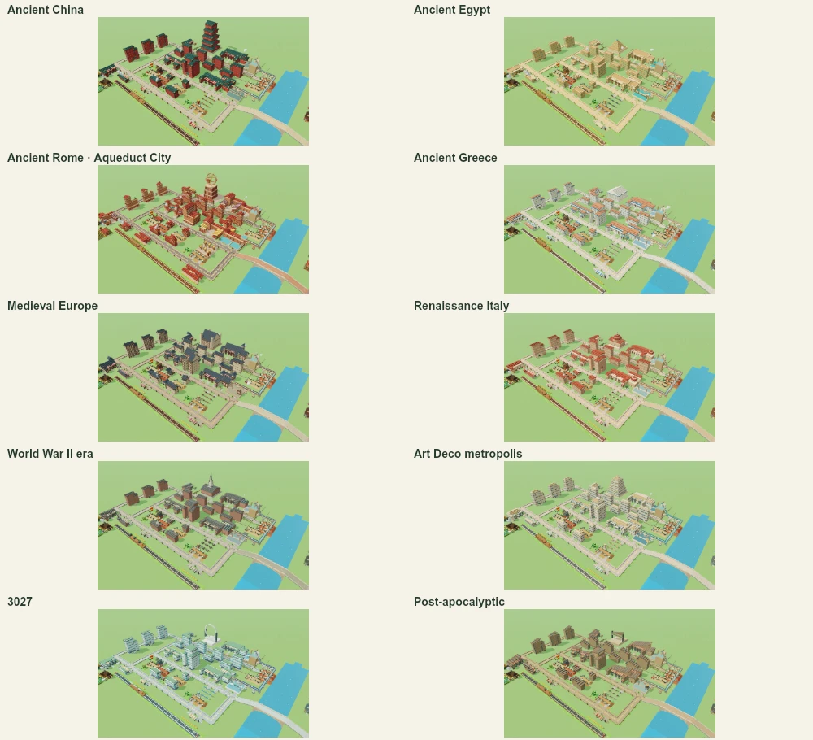
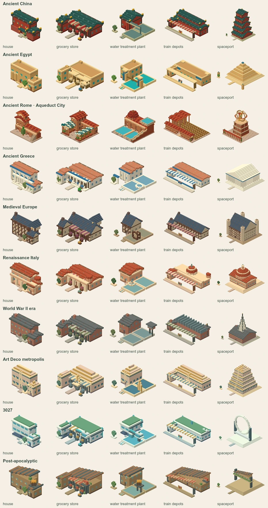

# Playing the time periods

[Open the time period library](https://pixelcivilization.app/eras.html) and choose an era. Each one has a starter street, a working district and a mature skyline. **Play this island** opens a free sample. Try the same task in several eras to see how the buildings, vehicles and streets change.

## Put an era on your own island

1. Open **More → View** and choose a time period. The view previews the change immediately. Your roads, buildings, levels and treasury stay where they are.
2. Select **Apply to island** to keep the design. **Cancel preview** returns to the previous look. **Show original names** keeps familiar building names while displaying the era artwork.
3. A locked era opens the **Island Store**. Your purchases follow the player account you use in the game. Previously purchased one-time packs remain available when a monthly plan ends.
4. To begin a separate city, choose **More → Saves → New island**, give it a name and choose its mode and time period.

## Read a building

Open the [Atlas](https://pixelcivilization.app/field-guide.html?id=house&level=2&variant=3&era=ancient-egypt). The link remembers the building, era, level and variant. Rotate a model to find its entrance, step between levels, or switch to Original to compare the same building. Open the sprite sheet for a side-by-side view of the levels and styles. The [Handbook](https://pixelcivilization.app/handbook.html#course=rome-flow&era=ancient-egypt) has practice scenarios for street access, public service, transit, water and upgrades.

## Choose a game edition

Original artwork, Real, Idle and Manager modes, the Atlas and all thirty tour islands are free. The store lists individual era packs at **$0.99**, Survival Mode at **$1.99**, and God Mode at **$3.99** before applicable web tax. Available purchase methods appear in **More → Island Store**.

| Monthly Pix plan | US web price | Messages per billing period | Game access while subscribed |
| --- | ---: | ---: | --- |
| Starter | $4.99 | 100 | Survival |
| Builder | $14.99 | 350 | Both modes, Rome and Egypt |
| Studio | $39.99 | 1,000 | Builder plus China, Greece, Medieval Europe and Renaissance Italy |
| Complete | $99.99 | 2,500 | Both modes and all ten eras |

In the web store, **At capacity** means there is too little prepaid AI credit to offer the full allowance for one more player at that tier. When a plan opens, set up a payment method and choose **Review and pay first invoice** to see the exact total with tax. **Check payment status** retrieves the result. **Stop Pix renewal** ends future renewals and keeps access through the paid period. One-time era and mode purchases stay in your library.

Open **Pix → Advise with Pix** for help with your current island. The model selector names the provider that will receive your request. To flag an answer, building or world plan, choose **Report this result**, review the excerpt and send it directly to the game team.

Each plan has a separate AI usage budget shown beside its message allowance. Reaching either cap pauses paid messages until renewal. You can still play your islands. A signed-in device can use its last verified paid access offline for up to seven days, subject to the subscription end date. Reconnect to refresh it.

The [Android and Windows downloads](https://pixelcivilization.app/downloads.html) save islands on the device. In those editions, opening the game online lets it check for an update. The updated game is available on a subsequent launch. On any device, **More → Account** connects your saves to your account.

For every design and the recorded simulation checks, see the [illustrated art and city review](review/period-production/art-and-cities.md).
